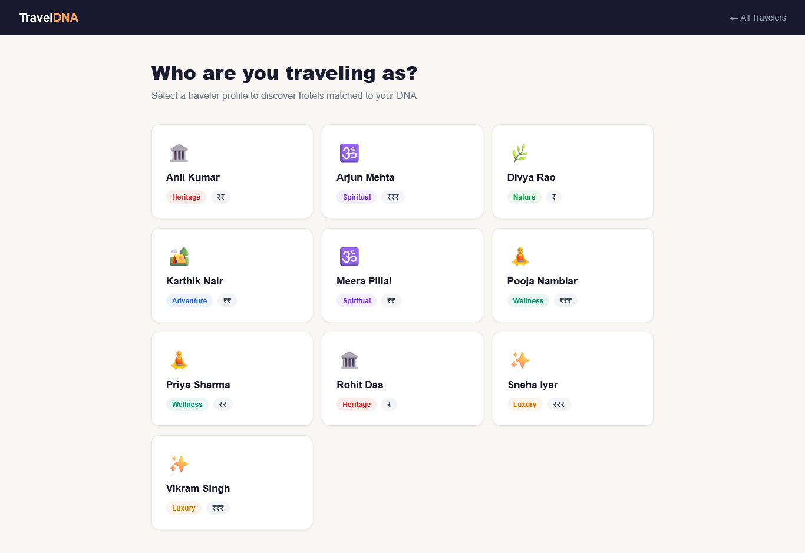
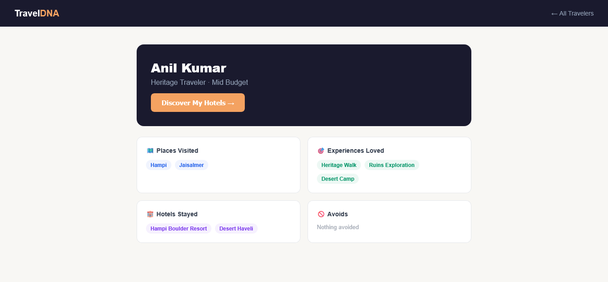
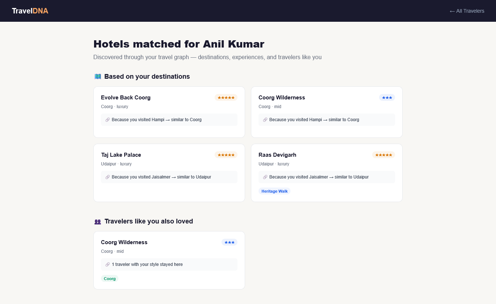
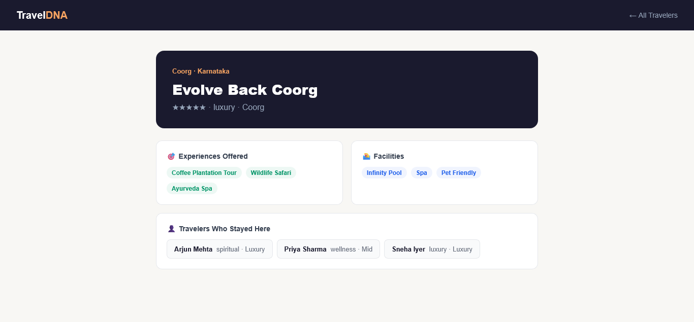

# TravelDNA 🧬

A hospitality intelligence graph that maps relationships between traveler lifestyle preferences, destinations, hotels, and experiences — using those connections to surface non-obvious hotel recommendations.

**Live Demo:** https://traveldna.vercel.app  
**Backend API:** https://traveldna-server-production.up.railway.app

---

## Why a Graph Database?

A traveler's decision isn't a form — it's a web of connected preferences. When someone decides to travel, their choice of destination, hotel, and experiences all emerge from interconnected lifestyle signals.

A relational database would model this as separate tables with junction tables connecting them. But the interesting questions are about **connections across multiple hops**:

> "Find hotels in destinations similar to places this traveler loved, that offer experiences they prefer, excluding anything they avoid"

In SQL this requires 5+ joins with subqueries. In Cypher it's a natural 3-hop traversal. Graph databases also make "travelers like you" queries trivial — following relationship paths that would require expensive self-joins in SQL.

CognoDB (Neo4j-compatible) earns its place here because **relationships are the data**, not just foreign keys.

---

## Data Model

Nodes:

- Traveler — id, name, budget_band, travel_style
- Destination — id, name, region, type
- Hotel — id, name, city, stars, price_band
- Experience — id, name, type
- Facility — id, name

Relationships:

- (Traveler)-[:VISITED]->(Destination)
- (Traveler)-[:STAYED_AT]->(Hotel)
- (Traveler)-[:PREFERS]->(Experience)
- (Traveler)-[:AVOIDS]->(Facility)
- (Hotel)-[:LOCATED_IN]->(Destination)
- (Hotel)-[:OFFERS]->(Experience)
- (Hotel)-[:OFFERS]->(Facility)
- (Destination)-[:SIMILAR_TO]->(Destination)

### Diagram

```
[Traveler] --VISITED--> [Destination] --SIMILAR_TO--> [Destination]
    |                                                       |
 PREFERS                                              LOCATED_IN
    |                                                       |
[Experience] <--OFFERS-- [Hotel] <--STAYED_AT-- [Traveler]
                            |
                          OFFERS
                            |
                       [Facility] <--AVOIDS-- [Traveler]
```

---

## Setup & Run

### Prerequisites

- Node.js 18+
- CognoDB Cloud account (free tier — no credit card)

### 1. Create CognoDB Instance

1. Go to https://console.cognodb.com/signup
2. Create a free (c0) instance
3. Save your connection URI and password — shown only once

### 2. Clone & Install

```bash
git clone https://github.com/prajwalpoojary/traveldna.git
cd traveldna
cd server && npm install
cd ../client && npm install
```

### 3. Configure Environment

Create server/.env:

```
NEO4J_URI=bolt+s://your-instance.databases.cognodb.com
NEO4J_USER=cognodb
NEO4J_PASSWORD=your_password
PORT=3001
```

### 4. Seed the Database

```bash
cd server
npm run seed
```

### 5. Run Locally

Open two terminals:

Terminal 1 — Backend:
```bash
cd server && npm run dev
```

Terminal 2 — Frontend:
```bash
cd client && npm run dev
```

Open http://localhost:5173

---

## Main Queries Explained

### Query 1 — Destination-Based Recommendations (3-hop traversal)

Find hotels in destinations similar to places this traveler loved, that offer experiences they prefer.

```cypher
MATCH (t:Traveler {id: $id})-[:STAYED_AT]->(stayed:Hotel)
WITH t, collect(stayed.id) as stayedIds
MATCH (t)-[:VISITED]->(d:Destination)-[:SIMILAR_TO]->(similar:Destination)<-[:LOCATED_IN]-(h:Hotel)
WHERE NOT h.id IN stayedIds
OPTIONAL MATCH (h)-[:OFFERS]->(e:Experience)<-[:PREFERS]-(t)
RETURN h, similar, d.name as becauseYouVisited, collect(e.name) as matchingExperiences
ORDER BY size(collect(e.name)) DESC
LIMIT 6
```

This is a 3-hop traversal: Traveler → Destination → Similar Destination → Hotel. In SQL this requires self-joins on destinations and multiple subqueries. In Cypher it reads naturally.

### Query 2 — Social Recommendations (travelers like you)

Find travelers with similar style and budget who stayed somewhere you haven't.

```cypher
MATCH (t:Traveler {id: $id})-[:STAYED_AT]->(stayed:Hotel)
WITH t, collect(stayed.id) as stayedIds
MATCH (t)-[:PREFERS]->(e:Experience)<-[:PREFERS]-(similar:Traveler)-[:STAYED_AT]->(h:Hotel)
WHERE NOT h.id IN stayedIds
AND t.budget_band = similar.budget_band
AND similar.id <> $id
MATCH (h)-[:LOCATED_IN]->(d:Destination)
RETURN h, d, COUNT(similar) as popularity
ORDER BY popularity DESC
LIMIT 4
```

Finding users connected through shared preferences then following their behavior is exactly what graph databases do naturally. In SQL this is a 3-way self-join with aggregation.

### Query 3 — Hotel Detail with Full Graph Connections

```cypher
MATCH (h:Hotel {id: $id})-[:LOCATED_IN]->(d:Destination)
OPTIONAL MATCH (h)-[:OFFERS]->(e:Experience)
OPTIONAL MATCH (h)-[:OFFERS]->(f:Facility)
OPTIONAL MATCH (t:Traveler)-[:STAYED_AT]->(h)
RETURN h, d,
  collect(DISTINCT e) as experiences,
  collect(DISTINCT f) as facilities,
  collect(DISTINCT t) as guests
```

---

## Screenshots

### Home — Traveler Selection


### Profile — TravelDNA


### Recommendations — Graph-Powered


### Hotel Detail — Graph Connections


---

## Tech Stack

| Layer | Technology |
|---|---|
| Frontend | React + Vite |
| Backend | Node.js + Express |
| Database | CognoDB (Neo4j-compatible, openCypher) |
| Driver | Official Neo4j JavaScript Driver |
| Hosting | Vercel (frontend) + Railway (backend) |

---

## Project Structure

```
traveldna/
├── client/
│   ├── src/
│   │   ├── api/index.js
│   │   ├── components/
│   │   └── pages/
│   └── package.json
└── server/
    ├── src/
    │   ├── db.js
    │   ├── seed.js
    │   └── routes/
    └── package.json
```